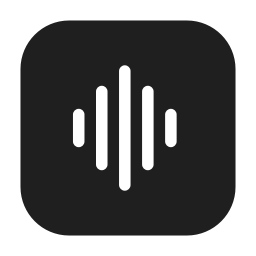
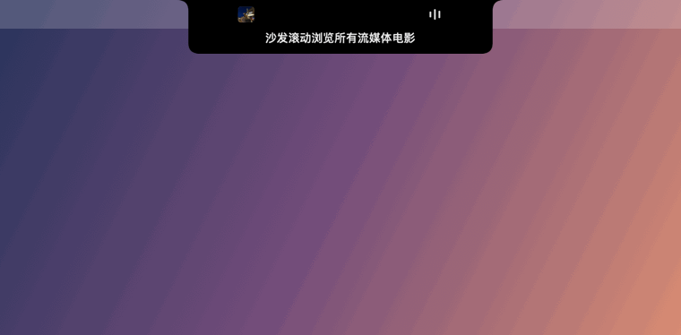

<h1 align="center">
  
  <br>
  NotchPod
</h1>

<p align="center">
  <b>A minimal podcast listener in your notch, with bilingual captions.</b>
</p>

<p align="center">
  
  
  
  
  
</p>

<p align="center">
  
</p>

Hover over the notch to listen; move away and it tucks back in while the audio keeps going. Turn on captions and NotchPod transcribes the episode **on your Mac**, a little ahead of the playhead, then translates it into your language. No window, no Dock icon, no account.

## Install

**One line** (recommended; skips the unidentified-developer warning):

```bash
curl -fsSL https://raw.githubusercontent.com/jiatastic/NotchPod/main/scripts/install.sh | bash
```

**Or drag and drop:** download **[NotchPod.dmg](https://github.com/jiatastic/NotchPod/releases/latest/download/NotchPod.dmg)**, open it, and drag NotchPod into Applications. NotchPod isn't notarized yet, so on first launch go to **System Settings → Privacy & Security → Open Anyway**.

Requires an Apple Silicon Mac with a notch and macOS 14 or later (macOS 15 or later for translation). Macs without a notch get a menu-bar popover instead.

## Features

- **Notch player.** Hover to open, move away to tuck, with an interruptible spring animation. It never steals focus.
- **Bilingual captions.** The original line sits on top and the translation underneath, Immersive Translate style. While the notch is tucked, one line hangs under the camera. Use the captions button to pick Off, Original or Bilingual, and the language to translate to.
- **On-device only.** Apple's speech recognition and translation run locally. NotchPod has no accounts, analytics or API keys.
- **Sentence-aware rewind.** With captions on, ⟲ jumps to the start of the sentence you missed.
- **One search field** for episodes and shows from Apple's directory, plus any public RSS feed, including video.

`⌘K` search · `Space` play/pause · `⌘←` back a sentence · `⌘→` forward 30s · `Esc` tuck

## Build from source

```bash
git clone https://github.com/jiatastic/NotchPod.git && cd NotchPod
bash scripts/build-app.sh && open dist/NotchPod.app
bash scripts/e2e.sh    # end-to-end tests
```

No third-party dependencies. Architecture and design notes: [`docs/DEVELOPMENT.md`](docs/DEVELOPMENT.md). History: [`CHANGELOG.md`](CHANGELOG.md).

## Credits

Inspired by [boring.notch](https://github.com/TheBoredTeam/boring.notch), [Immersive Translate](https://immersivetranslate.com) and [Language Reactor](https://www.languagereactor.com). Licensed under [GPL-3.0](LICENSE).
