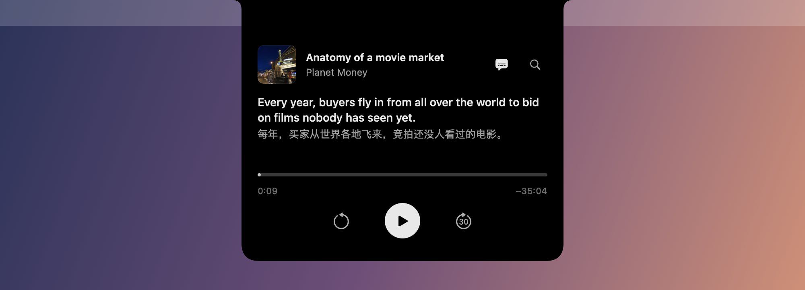
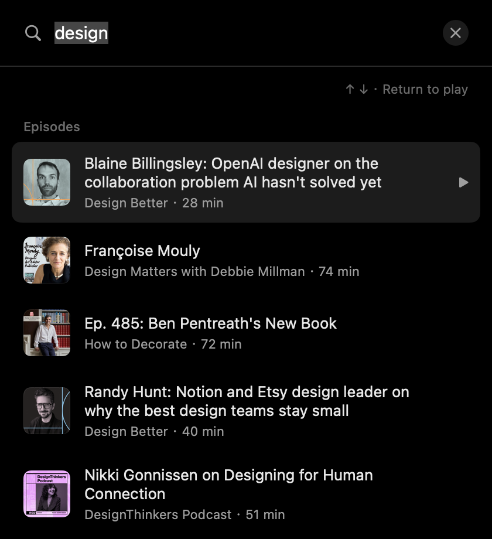

<h1 align="center">
  
  <br>
  NotchPod
</h1>

<p align="center">
  <b>A podcast player that lives in your MacBook's notch, with live bilingual captions.</b>
  <br>
  Hover to listen. Glance to understand. Nothing to manage.
</p>

<p align="center">
  
  
  
  
  
</p>

<p align="center">
  
</p>

NotchPod turns the notch into a quiet little podcast player. Hover over the camera and the player slides out; move away and it tucks back in while the audio keeps going. It has no main window, no Dock icon and no account.

Turn on captions and NotchPod **transcribes the episode on your Mac** a little ahead of where you're listening, then **translates it into your language**. While you work, the current line sits under the notch, so a glance is enough to follow a podcast in a language you're still learning.

<p align="center">
  
</p>

## Features

- **Lives in the notch.** Hover to open, move away to tuck. Opening uses an interruptible spring animation and never steals keyboard focus.
- **Live bilingual captions.** The original line stays primary and the translation sits underneath, in the style of [Immersive Translate](https://immersivetranslate.com). While the notch is tucked, one line of caption hangs below the camera. Clicks pass through it to the apps underneath.
- **Look-ahead transcription.** Audio is recognized in 45-second chunks starting at the playhead, about 20× faster than real time on Apple Silicon, so captions are ready before you hear the words.
- **Sentence-aware rewind.** With captions on, ⟲ goes back to the start of the sentence you just missed instead of a blind 15 seconds.
- **Search everything from one field.** Episodes and shows from Apple's podcast directory appear as you type. Click an episode to play it right away. Any public RSS feed works too, including video podcasts.
- **Remembers where you were.** Following, recent listening, per-episode progress, media keys and 0.8–2× speed.

<p align="center">
  
</p>

## Private by design

| | |
| --- | --- |
| **Speech recognition** | On-device only (`SFSpeechRecognizer` with `requiresOnDeviceRecognition`). Audio never leaves your Mac. |
| **Translation** | Apple's on-device Translation framework. No API keys, no cloud. |
| **Accounts and analytics** | None. No server, no tracking, no sync. |
| **Network** | Apple's podcast directory for search, and publishers for feeds, artwork and audio. That's all. |
| **Permissions** | Speech Recognition, asked once, the first time you turn on captions. No Accessibility or Screen Recording. |

## Installation

**Requirements**
- A Mac with a notch, running macOS 14 Sonoma or later. On Macs without a notch, NotchPod opens as a menu-bar popover instead.
- macOS 15 or later for caption translation. Transcription works on 14.
- To build from source only: Xcode or the Command Line Tools with Swift 6.

### Download

**[⬇ Download NotchPod.zip](https://github.com/jiatastic/NotchPod/releases/latest/download/NotchPod.zip)**, unzip it, and move **NotchPod** to `/Applications`.

> [!IMPORTANT]
> NotchPod isn't notarized yet (that needs a paid Apple Developer account), so macOS will block the first launch. Run this once, then open it normally:
>
> ```bash
> xattr -dr com.apple.quarantine /Applications/NotchPod.app
> ```
>
> Or try to open it, then go to **System Settings → Privacy & Security** and click **Open Anyway**.

### Build from source

```bash
git clone https://github.com/jiatastic/NotchPod.git
cd NotchPod
bash scripts/build-app.sh
open dist/NotchPod.app
```

## Usage

1. **Hover the notch** to open the player. Move away and it tucks back in; the audio keeps playing.
2. **Click 🔍** to search for an episode or show, or to pick from what you follow and listened to recently.
3. **Click the captions button** next to search to turn on **Original** or **Bilingual** captions and pick the language to **Translate To**.
4. **First time translating into a language?** Click **Download** under the captions; macOS fetches the language pack once.

| Shortcut | Action |
| --- | --- |
| `⌘K` | Search |
| `Space` / `⌘P` | Play / pause |
| `⌘←` | Back one sentence (or 15s without captions) |
| `⌘→` | Forward 30s |
| `Esc` | Tuck the notch |

Shortcuts work while the player has focus.

## Roadmap

- [x] Notch player with hover-to-open spring motion
- [x] Unified episode and show search
- [x] Public RSS, including video podcasts
- [x] On-device look-ahead transcription
- [x] Bilingual captions with on-device translation
- [x] Sentence-aware rewind
- [ ] Notarized releases and a Homebrew cask
- [ ] `SpeechAnalyzer` (macOS 26) for better long-form accuracy and punctuation
- [x] Choose the translation language in the notch
- [ ] Click a word in a caption to look it up
- [ ] Search inside an episode's transcript and jump to that moment

## Development

```bash
bash scripts/test.sh                              # parsing, persistence and caption checks
QUIETCAST_LIVE_TESTS=1 bash scripts/test.sh       # also hits the live directory and plays audio
```

The project has no third-party dependencies. [`docs/DEVELOPMENT.md`](docs/DEVELOPMENT.md) covers architecture, notch geometry, hover timing, privacy details and verification status. Version history is in [`CHANGELOG.md`](CHANGELOG.md).

## Acknowledgments

- [boring.notch](https://github.com/TheBoredTeam/boring.notch) showed how much a notch can do.
- [Immersive Translate](https://immersivetranslate.com) and [Language Reactor](https://www.languagereactor.com) inspired the bilingual caption layout and sentence-level rewind.
- Apple's Speech, Translation and AVFoundation frameworks do the heavy lifting, entirely on-device.

## License

NotchPod is free software under the [GNU General Public License v3.0](LICENSE).
